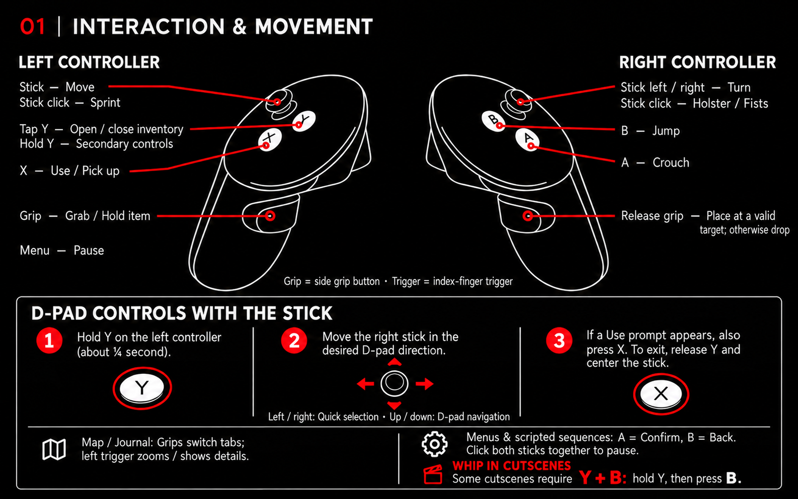
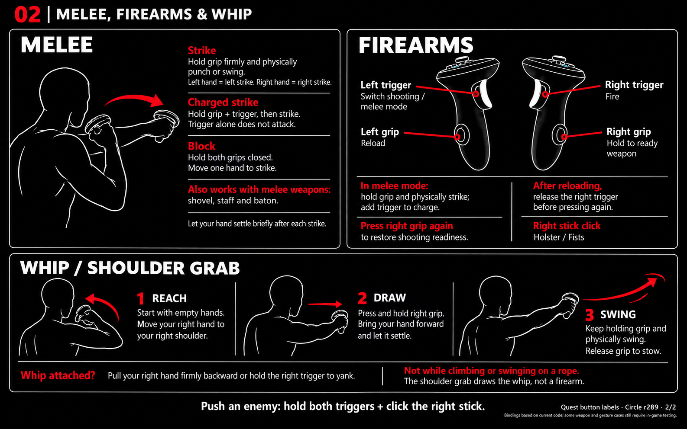

# KHARVOX: CIRCLE

A VR conversion mod for **Indiana Jones and the Great Circle**, made by Cactus.
Stereoscopic rendering, tracked motion controllers, physical melee, and a dedicated VR launcher.

> **Hardware requirement: at least 12 GB of VRAM.** Indiana Jones and the Great Circle is a very demanding game, especially in VR. Higher headset resolutions and graphics settings can require considerably more GPU performance and memory. Upscaling and frame generation do not remove this requirement.

[](https://ko-fi.com/cactusvrstudios/tip)

[Installation](#installation) · [Controller bindings](#controller-bindings) · [Building from source](#building-from-source) · [Support](#support)

## Installation

1. Download a release ZIP from [Releases](https://github.com/CactusVRStudios/KHARVOX-CIRCLE/releases).
2. Extract the complete archive into a new, writable folder. Keep all included files together; do not run the launcher from inside the ZIP or copy the mod into the game folder.
3. Connect your headset and controllers, then start your OpenXR runtime.
4. Run **CircleLauncher.exe**, select **TheGreatCircle.exe**, and configure your VR options.
5. Start the game through the launcher. Steam and GOG installations are supported for the game builds recognized by the launcher.

## Controller bindings

### Interaction



### Combat



## Instructions

Keep the game window focused while playing. Controller instructions are also available in the launcher and in the main and pause menus.

The VR intro runs before the game. After its first start, **Disable VR Intro** becomes available under **Rendering**. Launcher settings are stored per Windows user and carry over between releases.

Rendering options include upscaling and VR frame generation, with available backends depending on your GPU. Choose fixed frame-generation multipliers, **Auto** for conservative whole-number switching, or **Auto Seamless** for adaptive interpolation. Apply rendering changes before starting the game.

## Alpha status

CIRCLE is in active alpha development. Compatibility, performance, and some interactions can vary by headset, GPU, runtime, and game version. SteamVR and Virtual Desktop's VDXR have been tested; this does not guarantee every device configuration.

Report problems through [Issues](https://github.com/CactusVRStudios/KHARVOX-CIRCLE/issues), including the mod version, headset, GPU, runtime, and steps to reproduce. Enable logging in the launcher when collecting diagnostic logs; it is off by default.

## Building from source

The Windows build produces the Vulkan/OpenXR renderer, frame-generation components, and the CIRCLE launcher.

**Source checkout status:** this repository is a filtered source snapshot, not yet a self-contained build distribution. Tests, third-party payloads, and documentation/license resources are intentionally excluded. The current CMake configuration still references test sources, and launcher compilation embeds notice resources from the full development workspace. Restore these required inputs from a complete development checkout before using the commands below. Setting `CIRCLE_VR_BUILD_TESTS=OFF` alone does not disable the top-level CIRCLE test targets. For playing the mod, use a packaged release.

### Requirements

- Windows x64.
- Visual Studio 2022 with **Desktop development with C++**, MSVC x64 tools, and a Windows SDK. The included preset uses `Visual Studio 17 2022`.
- CMake 3.24 or newer, Git, and PowerShell. Run the commands in a Visual Studio Developer PowerShell.
- The Windows .NET Framework 4.x compiler and WPF assemblies used by `tools/build-launcher.ps1`.
- Internet access for the dependencies downloaded and checksum-verified by CMake.
- The complete project assets and the locally supplied dependencies listed below.

### Libraries and runtime dependencies

| Dependency | Purpose | Setup |
| --- | --- | --- |
| OpenXR loader and headers 1.1.63 | Headset/runtime integration | Downloaded and verified by CMake. |
| Vulkan headers | Vulkan layer integration | Uses an installed Vulkan SDK, or downloads pinned Vulkan-Headers 1.4.357. |
| SafetyHook 0.7.0 with Zydis | Native game hooks | Downloaded and verified by CMake. |
| NVIDIA DLSS SDK 310.9.1 | DLSS frame-generation integration | Set `CIRCLE_DLSS_SDK_ROOT` to a complete SDK checkout. Requires `include/nvsdk_ngx_helpers_dlssg_d3d.h` and the static x64 NGX libraries under `lib/Windows_x86_64/x64/`. |
| FidelityFX SDK 1.1.4 integration | AMD frame-generation backend | Restore the project's headers and matching `third_party/fidelityfx/bin/CircleFidelityFX_DX12.dll`. CMake verifies the expected binary hash; an arbitrary SDK DLL is not a substitute. |
| Community DLSS runtime 0.4.0 | Additional frame-generation backends | Restore the pinned RTX 20/30 and RTX 40 payloads under `runtimes/dlss-unlocked-0.4.0/`; packaging verifies them. |
| CIRCLE VR Intro | Intro before game launch | Supply the built `bin/KHARVOX CIRCLE Intro.exe`. The intro is built in its separate project. |

Dependency versions and checksums are defined in `src/circlevr/cmake/`, `cmake/NativeFramegen.cmake`, `CMakeLists.txt`, and `tools/install-community-framegen.ps1`.

### Configure and compile

Clone the repository:

```powershell
git clone https://github.com/CactusVRStudios/KHARVOX-CIRCLE.git
cd KHARVOX-CIRCLE
```

After restoring the development inputs described above, configure the build. Replace the SDK path with your installation:

```powershell
cmake --preset windows-x64 -DCIRCLE_DLSS_SDK_ROOT="C:/Dependencies/DLSS"
cmake --build --preset windows-x64
```

The build uses `RelWithDebInfo`. Native runtime output is written to `bin/`, and the launcher is written to `CircleLauncher.exe` in the project root. The launcher can also be rebuilt separately:

```powershell
.\tools\build-launcher.ps1
```

Keep all required runtime files together. The launcher EXE alone is not a complete playable installation.

### Create a playable package

With the native build, launcher resources, intro, and runtime payloads available, choose an unused release name:

```powershell
.\tools\package-release.ps1 -Name KHARVOX-CIRCLE-Alpha-R999
```

The script builds the launcher, verifies the frame-generation payloads, and creates a runtime-only folder and ZIP under `releases/`. It refuses to overwrite an existing release. Developer documentation, tests, logs, and debug symbols are not included in the package.

### Development checks

The test sources and test scripts are kept in the full local development workspace. With those restored, run:

```powershell
ctest --test-dir build/x64 -C RelWithDebInfo --output-on-failure
```

Close the game before running the complete suite: launcher handoff tests use a simulated game process. Automated checks do not replace gameplay and headset testing.

## Support

If you enjoy CIRCLE and would like to support development, visit [Cactus VR Studios on Ko-fi](https://ko-fi.com/cactusvrstudios/tip).
